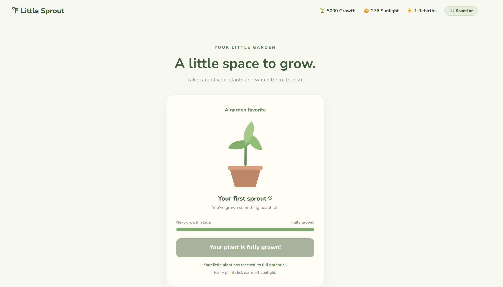
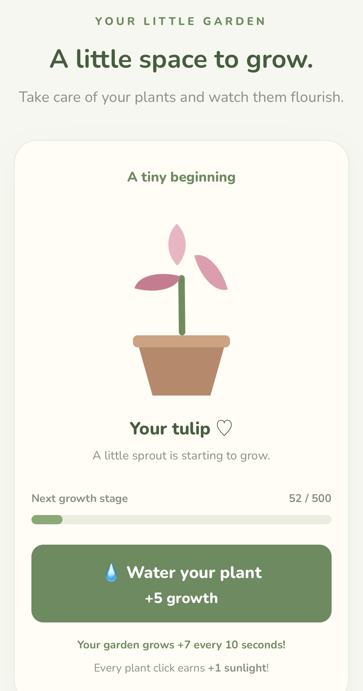

# Little Sprout 🌱

A cozy incremental flower-growing game built with HTML, CSS, and JavaScript. Grow plants, collect flowers, earn sunlight, upgrade your garden, and unlock rebirths as you progress.

## Features ‼️

- Grow flowers by clicking and watering.
- Earn sunlight through plant interactions.
- Automatic growth over time.
- Garden shop with five purchasable upgrades.
- 35 upgrade levels for each garden improvement.
- Collect and unlock six unique flowers.
- Individual growth progress for every flower.
- Rebirth system with increasing sunlight rewards.
- Garden progress saved automatically using LocalStorage.
- Sound effects with a mute option.
- Final completion goal: Max out all upgrades, collect every flower, and fully grow your entire collection.
- Responsive design for desktop, tablets, and mobile devices.

## Garden Upgrades ❣︎

- **Rich Compost:** Increases automatic growth.
- **Better Watering Can:** Increases growth per watering.
- **Sun Catcher:** Generates additional sunlight over time.
- **Growth Fertilizer:** Boosts automatic growth.
- **Garden Helper:** Automatically grows your selected plant and earns sunlight.

Each upgrade can be purchased up to level 35.

## Flower Collection ✿

Discover and grow six different flowers:

- 🌱 Little Sprout
- 🌷 Tulip
- 🪻 Lavender
- 🌻 Sunflower
- 🌹 Rose
- 🏵️ Hibiscus

Every new flower increases your garden's automatic growth bonus.

## Screenshots 📸

### Desktop

### Mobile

## Technologies Used 🌷

- HTML
- CSS
- JavaScript (Vanilla)
- LocalStorage
- Google Fonts (Nunito)

## How to Play 🍃

1. Click your plant to help it grow and earn sunlight.
2. Water your plant for additional growth.
3. Purchase upgrades in the Garden Shop.
4. Unlock new flowers using sunlight.
5. Grow a flower completely to unlock rebirth.
6. Rebirth your garden to receive additional starting sunlight and begin again.
7. Max out all five upgrades, collect all six flowers, and fully grow every flower to complete your garden!

## Saving Progress

Your garden progress is automatically saved in your browser using LocalStorage. Your progress will remain available when you return using the same browser and website origin.